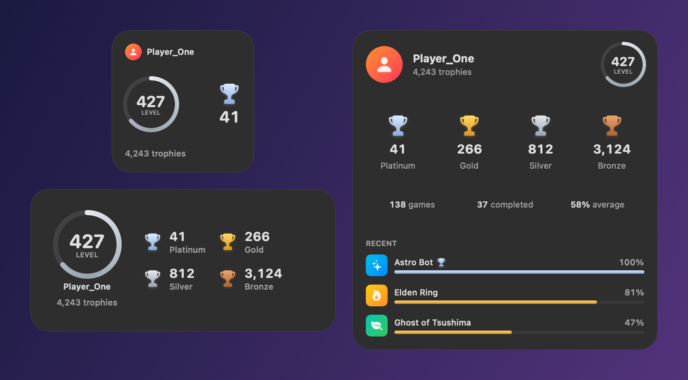
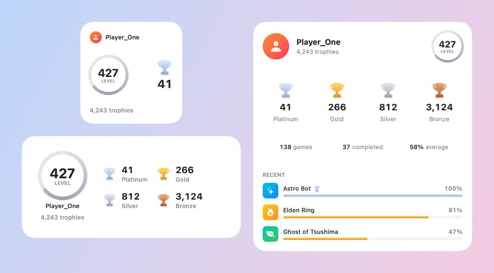

# 🏆 Widget PSNTrophies

🇬🇧 **English** · 🇫🇷 [Français](README.fr.md)

A native widget for your Mac desktop that shows your **PlayStation trophies** in Apple's style: level, platinum / gold / silver / bronze, number of games, games completed at 100%, average completion and your most recently played games.

<p align="center">
  
</p>

<p align="center">
  
</p>

<sub>Screenshots made with fake data.</sub>

- **3 sizes**: small, medium, large
- **English or French**, following your Mac's language
- **Follows your Mac's look**: light, dark, tinted, clear
- **Updates automatically** about every 30 minutes
- **Official PlayStation Network data** (the same data PSNprofiles uses)
- **No third-party server**: your Mac talks directly to Sony, nothing is sent anywhere else

---

## What you need

| | |
|---|---|
| 💻 A Mac running **macOS 14 Sonoma** or later | |
| 🛠️ **Xcode** (free) | [App Store](https://apps.apple.com/app/xcode/id497799835) |
| 🍎 An **Apple ID** (free, your App Store one works) | no paid developer membership needed |
| 🎮 A **PlayStation Network account** | |

Allow about **10 minutes** the first time, not counting the Xcode download.

---

## Installation, step by step

### 1. Install Xcode

1. Install **Xcode** from the [App Store](https://apps.apple.com/app/xcode/id497799835). It's big (several GB), so give it some time.
2. **Open Xcode once.** Accept the license and let it install its components. Once you see the welcome screen, you can move on.

### 2. Add your Apple ID to Xcode

Your Apple ID is used to "sign" the app. Without a signature, macOS won't show the widget.

1. In the menu bar: **Xcode → Settings…** (shortcut `⌘ ,`).
2. Open the **Accounts** tab.
3. Click **+** at the bottom left → **Apple ID** → **Continue**, then sign in.

### 3. Create your developer certificate

Still in **Settings → Accounts**:

1. Select your Apple ID on the left, then your **"Your Name (Personal Team)"** team on the right.
2. Click **Manage Certificates…**
3. Click **+** at the bottom left → **Apple Development**.
4. A certificate appears in the list: click **Done**. You can close Xcode.

### 4. Download the project

On this GitHub page: green **Code** button → **Download ZIP**. Open the downloaded ZIP to get the project folder.

<sub>Or, if you use git: `git clone` this repository.</sub>

### 5. Run the installer

**Easy way:** in the project folder, **right-click `Installer.command` → Open**, then confirm **Open**. macOS asks for confirmation the first time because the file comes from the internet. That's expected.

**Terminal way:** open the **Terminal** app, type `bash ` (with a space), drag the `install.sh` file into the window, then press **Return**.

The script does everything on its own:

```
▸ Checking Xcode                               ✓
▸ Looking for your Apple developer account     ✓ Team ID : XXXXXXXXXX
▸ Building (1–2 minutes the first time)        ✓
▸ Installing into Applications                 ✓
🏆 Done!
```

When it finishes, the **Widget PSNTrophies** app opens.

<sub>If macOS asks for keychain access during the build, enter your Mac login password and click **Always Allow**.</sub>

### 6. Connect your PlayStation account

The app needs a token called **NPSSO** to read your trophies. You only fetch it once, and the app then stays connected for about 2 months.

1. In your browser, sign in at **[playstation.com](https://www.playstation.com/)**.
2. In the **same browser**, open **[ca.account.sony.com/api/v1/ssocookie](https://ca.account.sony.com/api/v1/ssocookie)**.
3. You'll see a line like `{"npsso":"aBcD1234…"}`. Copy **the whole line** or just the value.
4. Paste it into the **Widget PSNTrophies** app and click **Connect**.

A preview of your stats appears in the app. If macOS asks whether the app may *access data from other apps*, click **Allow**: that's what lets the widget read your stats.

> ⚠️ **Never share your NPSSO token**: it gives access to your PlayStation account.

### 7. Add the widget to your desktop

1. **Right-click the desktop** → **Edit Widgets…**
2. Search for **"Widget PSNTrophies"**.
3. Pick a size and drag it onto the desktop. You can add several.

You're done! 🎉

---

## FAQ and troubleshooting

<details>
<summary><b>The widget has no colors (gray / white)</b></summary>

This is controlled by macOS, not by the app:

- **System Settings → Desktop & Dock → Widgets → Widget style**: with **Monochrome**, every widget is always gray. With **Automatic**, widgets turn monochrome whenever a window is in front and get their colors back when you click the desktop. Choose **Full-color** to keep colors all the time.
- **System Settings → Appearance → Icon & widget style**: with **Clear** or **Tinted**, every widget (this one included) follows that style, like the Dock icons.
</details>

<details>
<summary><b>"No developer certificate found"</b></summary>

Redo [step 3](#3-create-your-developer-certificate), then run the script again. If you have several accounts, you can pick the team to use: `bash install.sh YOURTEAMID`.
</details>

<details>
<summary><b>"Xcode isn't set up yet" or "Command Line Tools"</b></summary>

Open Xcode once and let it finish installing. If the script asks you to, also run this in Terminal:

```bash
sudo xcode-select -s /Applications/Xcode.app
```
</details>

<details>
<summary><b>"Invalid or expired NPSSO token"</b></summary>

The token changes every time you sign in again on playstation.com. Redo [step 6](#6-connect-your-playstation-account) with a fresh token.
</details>

<details>
<summary><b>"PlayStation session expired"</b></summary>

The connection lasts about 2 months. Open the app and paste a new NPSSO token (step 6).
</details>

<details>
<summary><b>The widget isn't in the list, or shows an old version</b></summary>

Open the Widget PSNTrophies app once, wait a few seconds, then try again. If needed, remove the widget from the desktop and add it back, or restart your Mac.
</details>

<details>
<summary><b>The app stops working after a few days</b></summary>

With a free Apple ID, Apple limits how long apps you build yourself stay valid. Just run `Installer.command` again: your PSN connection is kept.
</details>

<details>
<summary><b>Update or uninstall</b></summary>

- **Update:** download the new version of the project and run `Installer.command` again.
- **Uninstall:** remove the widget from the desktop, click **Sign Out** in the app, then move `/Applications/PSNTrophies.app` to the Trash.
</details>

---

## Privacy

- The code **contains no personal data**. Everyone builds the app with their own Apple account and signs in with their own PSN account.
- Your NPSSO token is sent **only to Sony's servers**. The app doesn't keep it: it only stores a refresh token and your latest stats, **only on your Mac**, in a space shared between the app and its widget.
- `install.sh` saves your Apple Team ID in `Config/Local.xcconfig`. That file is ignored by git, so it can never be published by mistake.

## Disclaimer

This project is **not affiliated with, endorsed by or sponsored by Sony Interactive Entertainment**. "PlayStation" and "PSN" are trademarks of Sony. The app uses the PlayStation Network API unofficially, like other community tools, and Sony may change it at any time. Use it at your own risk and in line with PlayStation Network's terms of service.

---

## For developers

```
App/       Sign-in app (SwiftUI) + screenshot rendering
Widget/    WidgetKit extension (timeline, refresh)
Shared/    PSN API client, models, shared storage, widget views, translations
Config/    Signing.xcconfig (+ Local.xcconfig, generated, ignored)
```

- The Xcode project is generated with [XcodeGen](https://github.com/yonaskolb/XcodeGen) from `project.yml` (`xcodegen generate`). The `.xcodeproj` is committed, so you don't need XcodeGen to install.
- Before opening the project in Xcode, run `install.sh` once: it creates `Config/Local.xcconfig` with your Team ID.
- Translations live in `Shared/Localizable.xcstrings`, with English as the source language and French translated. Adding a language is a matter of filling that catalog in Xcode.
- To regenerate the screenshots, build in Debug, then run `PSNTrophies.app/Contents/MacOS/PSNTrophies --render-preview docs -AppleLanguages "(en)"`.

Licensed under [MIT](LICENSE).
